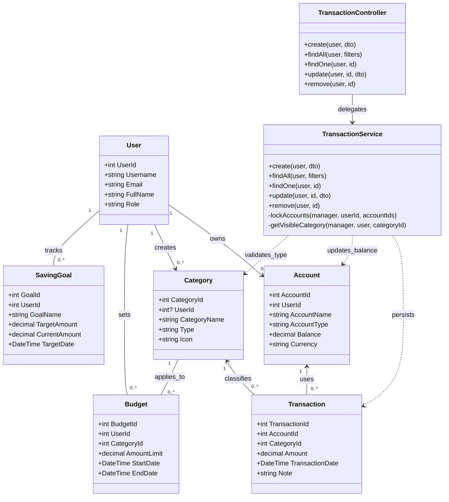
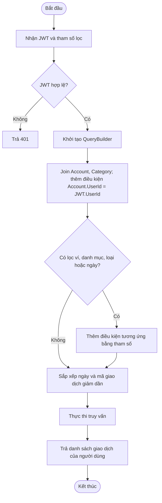
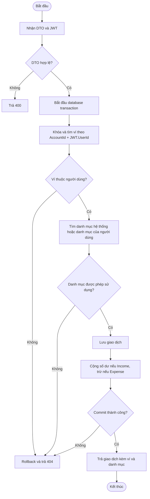
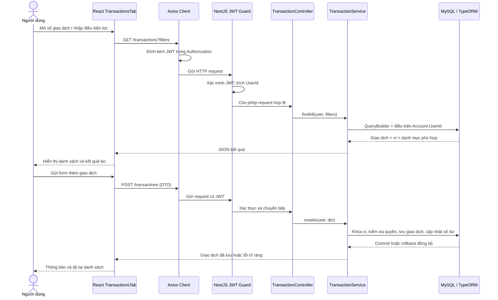

# 1. Tên dự án
**Xây dựng hệ thống quản lý chi tiêu cá nhân thông minh**

---

# 2. Phân tích bài toán

## 2.1. Phân tích các đối tượng (Entities / Classes)

* **User (Người dùng):** Đại diện cho tài khoản người sử dụng hệ thống.
  * *Thuộc tính:* `UserId`, `Username`, `PasswordHash`, `Email`, `FullName`, `CreatedAt`

* **Account / Wallet (Ví / Tài khoản ngân hàng):** Quản lý các nguồn tiền của người dùng (Ví cash, Tài khoản Vietcombank, Thẻ tín dụng...).
  * *Thuộc tính:* `AccountId`, `UserId`, `AccountName`, `AccountType`, `Balance`, `Currency`

* **Category (Danh mục thu/chi):** Phân loại giao dịch (Ăn uống, Lương, Giải trí, Tiền nhà...).
  * *Thuộc tính:* `CategoryId`, `UserId` (null nếu là danh mục mặc định của hệ thống), `CategoryName`, `Type` (Income/Expense), `Icon`

* **Transaction (Giao dịch):** Ghi nhận các khoản thu hoặc chi thực tế.
  * *Thuộc tính:* `TransactionId`, `AccountId`, `CategoryId`, `Amount`, `TransactionDate`, `Note`

* **Budget (Ngân sách / Hạn mức):** Đặt hạn mức chi tiêu cho từng danh mục trong một khoảng thời gian (VD: Ngân sách Ăn uống tháng 9 là 5,000,000 VNĐ).
  * *Thuộc tính:* `BudgetId`, `UserId`, `CategoryId`, `AmountLimit`, `StartDate`, `EndDate`

* **SavingGoal (Mục tiêu tiết kiệm):** Theo dõi các mục tiêu tài chính dài hạn (Mua xe, Du lịch...).
  * *Thuộc tính:* `GoalId`, `UserId`, `GoalName`, `TargetAmount`, `CurrentAmount`, `TargetDate`

---

## 2.2. Phân tích mối quan hệ giữa các đối tượng (Relationships)

* **User – Account (1 - N):** Một người dùng có thể sở hữu nhiều Ví/Tài khoản ngân hàng.
* **User – Category (1 - N):** Một người dùng có thể tự tạo nhiều danh mục thu/chi tùy chỉnh.
* **Account – Transaction (1 - N):** Một tài khoản/ví có thể phát sinh nhiều giao dịch thu/chi.
* **Category – Transaction (1 - N):** Một danh mục có thể chứa nhiều giao dịch liên quan.
* **User – Budget (1 - N):** Một người dùng có thể thiết lập nhiều hạn mức ngân sách khác nhau.
* **Category – Budget (1 - N):** Một ngân sách được gắn liền với một danh mục cụ thể.
* **User – SavingGoal (1 - N):** Một người dùng có thể khởi tạo nhiều mục tiêu tiết kiệm.

### 2.3. Phương thức hoạt động và yêu cầu nghiệp vụ

| Đối tượng | Phương thức/nghiệp vụ chính |
|---|---|
| `Transaction` | Tạo, đọc, cập nhật, xóa giao dịch; lọc theo ví, danh mục, loại thu/chi và khoảng ngày. |
| `Account` | Cung cấp ví thuộc người dùng hiện tại; số dư được cộng khi thu, trừ khi chi và hoàn nguyên khi giao dịch bị sửa/xóa. |
| `Category` | Phân loại giao dịch là `Income` hoặc `Expense`; người dùng chỉ chọn danh mục hệ thống hoặc danh mục của mình. |
| `User` | Xác thực bằng JWT; `UserId` trong token là căn cứ xác định chủ sở hữu dữ liệu, không nhận `UserId` từ trình duyệt. |
| `TransactionService` | Kiểm tra quyền sở hữu ví/danh mục, lọc dữ liệu và cập nhật giao dịch cùng số dư trong một transaction của CSDL. |

Yêu cầu chính: từ chối dữ liệu sai định dạng; không cho tạo giao dịch vào ví người khác; không làm lộ giao dịch giữa các người dùng; các thay đổi giao dịch và số dư phải được commit/rollback đồng thời.

---

## 2.4. Sơ đồ lớp UML (Class Diagram)



### 2.5. Sơ đồ thuật toán

**Lọc danh sách giao dịch** (mọi điều kiện là tùy chọn; phạm vi dữ liệu luôn bị giới hạn bởi `UserId` trong JWT):



**Tạo giao dịch**:



---

## 2.6. Báo cáo cấu trúc phân lớp NestJS

Backend chia trách nhiệm theo lớp, tránh để frontend truy cập trực tiếp CSDL:

| Lớp | Trách nhiệm | Thành phần |
|---|---|---|
| HTTP / Controller | Nhận route, JWT user, DTO và query; chuyển tiếp tới service. | `src/transaction/transaction.controller.ts` |
| Validation / DTO | Ràng buộc kiểu, số tiền dương, mã số, ngày, ghi chú; loại bỏ field không khai báo bởi `ValidationPipe`. | `src/transaction/dto/*.ts` |
| Nghiệp vụ / Service | Kiểm tra chủ sở hữu ví, quyền sử dụng danh mục; lọc bằng QueryBuilder; cập nhật giao dịch và số dư trong database transaction. | `src/transaction/transaction.service.ts` |
| Mô hình dữ liệu / Entity | Ánh xạ `Transaction`, `Account`, `Category` và quan hệ khóa ngoại. | `src/transaction/transaction.entity.ts`, `src/Account/Entity/account.entity.ts`, `src/category/category.entity.ts` |
| Truy cập dữ liệu | Repository/EntityManager TypeORM, kết nối MySQL từ biến môi trường; không bật `synchronize` trên CSDL. | `src/database/database.module.ts` |
| Bảo vệ API | Guard JWT toàn cục, CORS allowlist, Helmet, sanitize và validation. | `src/auth/guards/`, `src/main.ts` |

Frontend React chỉ gọi API qua `src/api/axiosClient.js`; Axios lấy token từ session hiện tại và gắn `Authorization` trong request interceptor. Token không được đưa vào URL, query string hay dữ liệu hiển thị. Backend vẫn là nơi xác thực token và quyết định quyền truy cập; việc ẩn giao diện ở frontend không thay thế kiểm tra quyền trên API.

## 2.7. Luồng xử lý thông tin chính (3b)



Các endpoint giao dịch (đều yêu cầu JWT):

| Method | Endpoint | Mô tả |
|---|---|---|
| GET | `/transactions` | Danh sách; hỗ trợ `AccountId`, `CategoryId`, `Type`, `FromDate`, `ToDate`. |
| GET | `/transactions/:id` | Chi tiết giao dịch thuộc ví của người dùng. |
| POST | `/transactions` | Tạo giao dịch, trường nhận gồm `AccountId`, `CategoryId`, `Amount`, `TransactionDate?`, `Note?`. |
| PATCH | `/transactions/:id` | Cập nhật giao dịch thuộc ví của người dùng. |
| DELETE | `/transactions/:id` | Xóa giao dịch và hoàn nguyên số dư ví. |

---

# 3. Auth & Security

## 3.1. Cài đặt & chạy

```bash
# 1) Database: chạy 1 lần để thêm cột Role vào bảng User
#    nestjs-backend/sql/auth-migration.sql

# 2) Backend
cd nestjs-backend
cp .env.example .env        # điền DB_*, JWT_SECRET, ADMIN_* (nếu chưa có .env)
npm install                 # cài thêm: bcryptjs, class-validator, class-transformer, helmet, dotenv, sanitize-html
npm run start:dev           # http://localhost:3000

# 3) Frontend
cd ../react-frontend
npm install
npm run dev                 # http://localhost:5173
```

Khi backend khởi động lần đầu, nếu DB chưa có admin, hệ thống tự tạo admin từ `ADMIN_USERNAME` / `ADMIN_PASSWORD` trong `.env`.

## 3.2. API

| Method | Endpoint | Quyền | Mô tả |
|---|---|---|---|
| POST | `/auth/register` | Public | `{ fullName, username, email, password }` — mật khẩu băm bằng bcrypt |
| POST | `/auth/login` | Public | `{ username (hoặc email), password }` → `{ access_token, user }` |
| GET | `/auth/me` | Đã đăng nhập | Thông tin user hiện tại |
| GET/PUT/DELETE | `/users`, `/users/:id` | Admin | Quản lý người dùng (không bao giờ trả `PasswordHash`) |
| GET/POST | `/accounts` | Đã đăng nhập | Chỉ ví của chính mình |
| CRUD | `/categories` | Đã đăng nhập | Danh mục hệ thống + danh mục của mình; chỉ sửa/xóa được danh mục của mình |

Các route cần đăng nhập gửi header: `Authorization: Bearer <access_token>`.

## 3.3. Các lớp bảo mật

| Lớp | Cách làm | File |
|---|---|---|
| Băm mật khẩu | bcrypt, 10 salt rounds; không bao giờ lưu/trả mật khẩu thô | `auth/auth.service.ts` |
| JWT | Ký bằng `JWT_SECRET` (.env), hết hạn `JWT_EXPIRES_IN`; `JwtStrategy` kiểm tra user còn tồn tại | `auth/strategies/jwt.strategy.ts` |
| Phân quyền | Guard toàn cục `JwtAuthGuard` + `RolesGuard`; `@Public()`, `@Roles('admin')` | `auth/guards/*`, `auth/decorators/*` |
| Chống brute-force | Sai 5 lần → khóa đăng nhập 15 phút | `auth/auth.service.ts` |
| CORS | Chỉ cho phép origin trong `CORS_ORIGINS` | `main.ts` |
| ValidationPipe | `whitelist`, `forbidNonWhitelisted`, `transform` + DTO dùng class-validator | `main.ts`, `**/dto/*.ts` |
| Chống XSS | `SanitizePipe` gỡ mọi thẻ HTML khỏi input trước khi validate; React tự escape khi hiển thị | `common/pipes/sanitize.pipe.ts` |
| Header bảo mật | `helmet()` | `main.ts` |
| Bí mật | DB password, JWT secret nằm trong `.env` (đã `.gitignore`) | `.env.example` |

## 3.4. Frontend

- `src/auth/session.js` — lưu phiên: mặc định `sessionStorage` (đóng tab là mất), tick "Ghi nhớ đăng nhập" thì dùng `localStorage`; tự xoá khi JWT hết hạn.
- `src/api/axiosClient.js` — tự gắn `Authorization: Bearer`, gặp 401 thì xoá phiên và về `/auth`.
- `src/auth/AuthContext.jsx` — `useAuth()` gồm `user`, `login`, `register`, `logout`; tải lại trang sẽ kiểm tra lại token qua `/auth/me`.
- `src/auth/ProtectedRoute.jsx` — chặn `/user`, `/admin` khi chưa đăng nhập hoặc sai vai trò.

## 3.5. Kiểm thử nhanh (Postman / curl)

```bash
curl -X POST localhost:3000/auth/register -H "Content-Type: application/json" \
  -d '{"fullName":"<script>alert(1)</script>Tuấn","username":"tuan01","email":"tuan@ex.com","password":"abc12345"}'
# -> fullName lưu thành "Tuấn" (thẻ script bị gỡ)

curl -X POST localhost:3000/auth/register -H "Content-Type: application/json" \
  -d '{"fullName":"A B","username":"x","email":"sai","password":"123","isAdmin":true}'
# -> 400: property isAdmin should not exist / tên đăng nhập / email / mật khẩu không hợp lệ

curl localhost:3000/users             # -> 401 (chưa đăng nhập)
curl localhost:3000/users -H "Authorization: Bearer <token của user thường>"   # -> 403
```

---

# 4. Ví (Wallet) & Ngân sách (Budget)

## 4.1. API

Tất cả đều cần đăng nhập (`Authorization: Bearer <token>`), và chỉ thao tác trên dữ liệu của chính user.

| Method | Endpoint | Mô tả |
|---|---|---|
| GET | `/accounts` | Danh sách ví |
| GET | `/accounts/summary` | Tổng số dư theo loại tiền + số ví |
| GET | `/accounts/:id` | Chi tiết 1 ví |
| POST | `/accounts` | Tạo ví `{ AccountName, AccountType?, Balance?, Currency? }` |
| PATCH | `/accounts/:id` | Sửa ví |
| DELETE | `/accounts/:id` | Xoá ví (xoá luôn giao dịch của ví — ON DELETE CASCADE) |
| GET | `/budgets` | Danh sách ngân sách, kèm `Spent`, `Remaining`, `Percent`, `Status` |
| GET | `/budgets/alerts` | Ngân sách đang áp dụng đã ≥ 80% (`warning`) hoặc vượt (`exceeded`) |
| POST | `/budgets/check` | Kiểm tra 1 khoản chi `{ CategoryId, Amount, Date? }` → `{ allowed, status, message }` |
| GET | `/budgets/:id` | Chi tiết 1 ngân sách |
| POST | `/budgets` | Tạo `{ CategoryId, AmountLimit, StartDate, EndDate }` (ngày dạng `YYYY-MM-DD`) |
| PATCH | `/budgets/:id` | Sửa ngân sách |
| DELETE | `/budgets/:id` | Xoá ngân sách |

## 4.2. Logic hạn mức (Budget Alerts)

- **Đã chi** = tổng `Transaction.Amount` của user, cùng danh mục, trong khoảng `StartDate` → `EndDate` (tính cả ngày cuối).
- **Trạng thái**: `ok` (< 80%), `warning` (≥ 80%), `exceeded` (> 100%).
- **Ràng buộc khi tạo/sửa ngân sách**: danh mục phải là loại *Expense*, ngày kết thúc ≥ ngày bắt đầu, không trùng thời gian với ngân sách khác của cùng danh mục.
- **Chặn vượt hạn mức**: `BudgetService.assertWithinBudget()` ném lỗi `400 BUDGET_EXCEEDED` nếu khoản chi làm tổng vượt hạn mức.

### Tích hợp vào phần Giao dịch (Transaction)

```ts
// transaction.module.ts
imports: [TypeOrmModule.forFeature([Transaction]), BudgetModule],

// transaction.service.ts — trước khi lưu một khoản CHI
constructor(private readonly budgetService: BudgetService, ...) {}

await this.budgetService.assertWithinBudget(userId, {
  CategoryId: dto.CategoryId,
  Amount: dto.Amount,
  Date: dto.TransactionDate, // 'YYYY-MM-DD'
});
// -> vượt hạn mức thì ném lỗi 400, giao dịch không được lưu
```

## 4.3. Frontend

- `src/pages/user/WalletsTab.jsx` — danh sách ví, tổng số dư, thêm/sửa/xoá ví.
- `src/pages/user/BudgetsTab.jsx` — thiết lập ngân sách, thanh tiến độ theo trạng thái, lọc "Đang áp dụng / Tất cả", công cụ "Kiểm tra trước khi chi".
- `src/pages/user/BudgetAlerts.jsx` — banner cảnh báo, hiện ở tab Tổng quan và tab Ngân sách.
- `src/api/walletApi.js`, `src/api/budgetApi.js` — gọi API.
